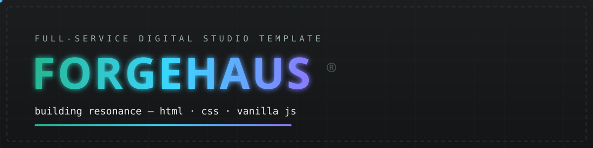
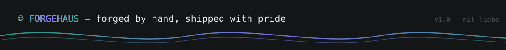

<div align="center">



<br/>


<br/><br/>

[](https://developer.mozilla.org/en-US/docs/Web/HTML)
[](https://developer.mozilla.org/en-US/docs/Web/CSS)
[](https://developer.mozilla.org/en-US/docs/Web/JavaScript)
[]()
[](LICENSE)
[](https://github.com/)

</div>


## ⚡ What is FORGEHAUS?

A dark, mono-first **creative studio / portfolio template** built as a single static page —
the kind of site you'd expect from an award-hunting digital agency, minus the build toolchain.

Every motion detail is hand-rolled in **pure HTML + CSS + vanilla JavaScript**:
a boot-style preloader, a physical custom cursor, velocity-reactive marquees, staggered
scroll reveals, count-up stats, a momentum drag gallery and magnetic buttons.

> **Zero frameworks. Zero dependencies. Zero build.** Open `index.html` — it just works.

<div align="center">

</div>


## 🧩 Feature Map

| Area                    | What's inside                                                               |
| ----------------------- | --------------------------------------------------------------------------- |
| 🖱️ **Custom cursor**    | Dot + trailing ring, hover grow, `drag` label state, auto-disabled on touch |
| ⏳ **Preloader**        | Staggered brand letters, eased 000→100 counter, curtain exit                |
| 🧭 **Smart header**     | Blur on scroll, hides on the way down, section-aware active nav             |
| 📜 **Hero marquee**     | Infinite text ticker + footer mega-ticker, speed reacts to scroll velocity  |
| 📊 **Stats**            | Four count-up counters with pad/suffix/decimal support                      |
| 🛠️ **Five disciplines** | Numbered service cards, tag pills, alternating artwork reveals              |
| 👥 **Client wall**      | Dashed 4-col grid with hover glow states                                    |
| 🗞️ **Journal gallery**  | Pointer-drag carousel with momentum, progress bar, click-guard              |
| ✉️ **Forms**            | Newsletter + contact with validation and friendly status messages           |
| ⏱️ **Living footer**    | Real-time studio clock, auto year, back-to-top                              |
| ♿ **A11y & motion**    | Skip link, focus-visible, full `prefers-reduced-motion` support             |


## 🚀 Quick Start

```bash
# clone it
git clone https://github.com/Muhammad112233-creator/Portfolio-Template-31.git
cd forgehaus-studio

# open it — that's the whole install
open index.html            # macOS
start index.html           # Windows
xdg-open index.html        # Linux
```

Or serve it like a pro (recommended, enables clean font loading):

```bash
python3 -m http.server 8080
# → http://localhost:8080
```


## 🗂️ Project Structure

```
forgehaus-studio/
├── index.html                  # the whole site — one file, nine sections
├── assets/
│   ├── css/
│   │   └── style.css           # design system, layout, motion, responsive
│   ├── js/
│   │   └── main.js             # cursor, preloader, marquees, gallery, forms…
│   ├── fonts/                  # self-hosted IBM Plex Mono + Poppins (OFL)
│   ├── img/
│   │   ├── art/                # five fine-art discipline artworks
│   │   ├── team/               # editorial studio portraits
│   │   ├── insights/           # journal thumbnails (duotone graded)
│   │   └── cover.jpg           # og:image / social cover
│   ├── readme/                 # animated svg art for this README
│   └── favicon.svg
├── .gitignore
├── LICENSE                     # MIT
└── README.md
```


## 🎨 Design Tokens

<details>
<summary><b>Click to expand the palette & type system</b></summary>
<br/>

| Token           | Value     | Used for                   |
| --------------- | --------- | -------------------------- |
| `--ink-900`     | `#17181a` | page background            |
| `--ink-800`     | `#1b1d1f` | raised surfaces / cards    |
| `--line-dash`   | `#494f52` | signature dashed 1px rules |
| `--grey-500`    | `#71797a` | muted text                 |
| `--grey-300`    | `#9bacae` | secondary text             |
| `--paper`       | `#e8ebeb` | primary text               |
| `--accent`      | `#25b895` | emerald accent             |
| `--accent-deep` | `#136157` | accent shade / hovers      |

```css
--font-mono: "IBM Plex Mono", monospace; /* UI, labels, body   */
--font-display: "Poppins", sans-serif; /* headlines, numbers */
--content-w: min(clamp(1040px, 82vw, 1420px), 100% - 2.5rem);
```

</details>

<details>
<summary><b>Make it yours in 5 minutes</b></summary>
<br/>

1. **Colors** — edit the tokens at the top of `assets/css/style.css`.
2. **Fonts** — swap the `@font-face` blocks and drop your `.woff2` files into `assets/fonts/`.
3. **Copy** — all text lives in plain `index.html` sections, clearly commented.
4. **Artwork** — replace images in `assets/img/` keeping the same filenames.
5. **Contact form** — the submit handler in `assets/js/main.js` is a marked stub; point it at Formspree, Netlify Forms or your own endpoint.

</details>


## 🤝 Contributing

Spotted a rough edge? PRs are welcome:

1. Fork the repo & create a branch: `git checkout -b feat/my-polish`
2. Keep it dependency-free — that's the whole point ✌️
3. Test with `prefers-reduced-motion` enabled
4. Open the PR with a before/after screenshot


## ⚖️ License & Credits

- **Code** — released under the [MIT License](LICENSE). Use it, remix it, ship it.
- **Fonts** — [IBM Plex Mono](https://github.com/IBM/plex) & [Poppins](https://github.com/itfoundry/Poppins), both SIL Open Font License.
- **Artwork & imagery** — original, generated for this template; fictional studio, people, clients and articles. Any resemblance to real brands is coincidental.
- **Inspiration** — the award-winning German agency sites of the mid-2020s; rebuilt here from scratch as an original, dependency-free implementation.


<div align="center">



**If this template saved you a weekend, drop a ⭐ — it keeps the forge lit.**

</div>
